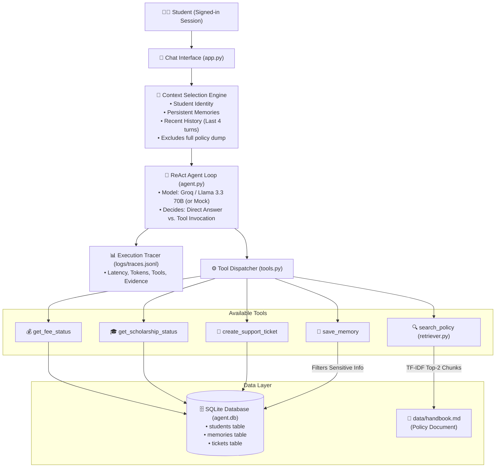

# 🎓 Intelligent Student Support Agent (Assignment 1)

An intelligent, tool-using AI student support assistant that dynamically answers common student queries (tuition fees, scholarship status, policy information, and support requests) through a ReAct agent loop, persistent cross-session memory, selective policy retrieval (RAG), and execution tracing.

---

## 1. System Architecture



---

## 2. Project File Structure

| File | Purpose & Responsibilities |
|---|---|
| [`agent.py`](agent.py) | ReAct agent loop (max 5 steps), context selection, dynamic tool calling, trace logging |
| [`tools.py`](tools.py) | 5 tools + function schemas (`get_fee_status`, `get_scholarship_status`, `search_policy`, `create_support_ticket`, `save_memory`) |
| [`retriever.py`](retriever.py) | Policy section chunking, TF-IDF top-2 retrieval, cosine score threshold (`0.20`) |
| [`memory.py`](memory.py) | Persistent cross-session memory; regex filtering against OTPs, passwords, and temporal words |
| [`db.py`](db.py) | SQLite database management (`agent.db`) and table seeding |
| [`llm.py`](llm.py) | OpenAI-compatible client (Groq Llama 3.3 70B default) + offline mock model with retry backoff |
| [`app.py`](app.py) | Streamlit web interface with interactive student chat, memory manager, and tracing inspector |
| [`evaluate.py`](evaluate.py) | Automated test benchmark verifying task accuracy, latency, and token consumption |
| [`data/`](data/) | `handbook.md` (institutional policy document), `students.json` (sample student records) |

---

## 3. How to Run

```bash
# 1. Install dependencies
pip install -r requirements.txt

# 2. Configure environment (copy example)
cp .env.example .env.local

# 3. (Optional) Set your Groq API key in .env.local
# GROQ_API_KEY=gsk_...
# Without a key, the built-in offline rule-based mock model runs automatically!

# 4. Launch the chat interface
streamlit run app.py

# 5. Run evaluation benchmark
python evaluate.py
```

- **Student Sign-in**: Student ID `S1001` (Password: `demo123` or configured in `.env.local`).

---

## 4. Assignment 1 — Core Concepts Demonstrated

| Requirement | Implementation Detail | Source File |
|---|---|---|
| **Working Agent Loop** | ReAct loop dynamically decides whether to answer directly or call one or more tools before responding. | [`agent.py`](agent.py) (`chat()`) |
| **≥ 2 Useful Tools** | 5 functional tools provided: `get_fee_status`, `get_scholarship_status`, `create_support_ticket`, `save_memory`, `search_policy`. | [`tools.py`](tools.py) |
| **Persistent Memory** | Retains preferences across sessions in SQLite; filters out transient words and sensitive credentials (OTPs, passwords). | [`memory.py`](memory.py) |
| **Selective Policy Retrieval (RAG)** | Chunks policy document into semantic sections; TF-IDF top-2 chunks returned; score threshold (`0.20`) flags missing info. | [`retriever.py`](retriever.py) |
| **Context Selection** | Passes only current question + relevant retrieved chunks + recent 4 history turns + student identity. Avoids full document dumps. | [`agent.py`](agent.py) (`_context()`) |
| **Missing Information Handling** | Questions not covered by policy return clean "not enough information" responses rather than hallucinating. | [`retriever.py`](retriever.py) |
| **Execution Tracing** | Logs tools called, retrieved evidence chunks, end-to-end latency, and token consumption per query. | [`app.py`](app.py), `logs/traces.jsonl` |

---

## 5. Evaluation Benchmark & Traces

Running `python evaluate.py` produces empirical measurements across the defined test questions:

| Test ID | Category | Question | Tools Used | Retrieved Evidence | Latency (s) | Tokens (In / Out) | Success |
|:---:|:---:|:---|:---|:---|:---:|:---:|:---:|
| **T01** | Task | What is my current fee status? | `get_fee_status` | — | 0.001s | 1,381 / 54 | ✅ Pass |
| **T02** | Task | The payment portal failed. Can I pay on the next working day? | `search_policy` | C02 Payment Portal Failure (0.531) | 0.002s | 1,529 / 140 | ✅ Pass |
| **T03** | Task | What is the minimum attendance requirement? | `search_policy` | C07 Attendance Requirement (0.399) | 0.001s | 1,693 / 99 | ✅ Pass |
| **T04** | Task | Raise a support ticket: hostel wifi is not working | `create_support_ticket` | — | 0.001s | 1,772 / 77 | ✅ Pass |
| **T05** | Task | Please remember that I prefer email communication in English. | `save_memory` | — | 0.001s | 1,849 / 69 | ✅ Pass |
| **T06** | Task | Do you remember my preferred communication? | (Direct answer from memory) | Stored memory item | 0.000s | 692 / 29 | ✅ Pass |
| **T07** | Task | Is there a gym membership discount for students? | `search_policy` (0 chunks) | Insufficient info fallback | 0.001s | 1,467 / 81 | ✅ Pass |

**Task Accuracy: 7 / 7 (100%)**

---

## 6. Suggested Demonstration Scenarios

1. **Fee Status**: `"What is my current fee status?"` ➔ calls `get_fee_status` and displays balance.
2. **Payment Failure**: `"The payment portal failed. Can I pay on the next working day?"` ➔ retrieves policy chunk `C02` explaining next-working-day exemption.
3. **Persistent Memory**: `"Please remember that I prefer email communication in English."` ➔ saves preference to database; recalls it in subsequent questions.
4. **Sensitive Data Protection**: `"My OTP is 482913, please remember it."` ➔ agent refuses to persist one-time credentials.
5. **Out-of-Policy Fallback**: `"Is there a gym membership discount for students?"` ➔ reports that the handbook lacks this information.
